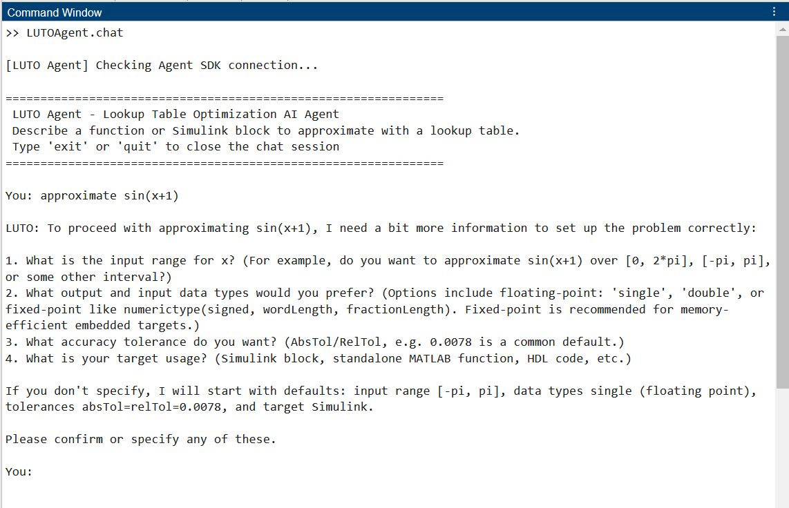

# Optimize Lookup Tables Using an AI Agent

Lookup tables (LUTs) are an efficient way to write computationally-intense functions.
Creating an optimized lookup table requires iteration, which you can automate using the
lookup table optimization tools in Fixed-Point Designer™.

The **Lookup Table Optimization Agent (LUTO Agent)** is an interactive MATLAB® AI agent that provides a conversational interface for creating optimized lookup tables.
If your workflow involves approximating mathematical functions, control logic, or Simulink® blocks with lookup tables for deployment or performance optimization, this agent can help automate much of the exploration and tuning process.
You describe the math
function or Simulink® block that you want to approximate in plain language,
and the agent guides you through the approximation workflow. The agent is built
on the [MATLAB AI Agent SDK](https://github.com/matlab/matlab-ai-agent-sdk).



## Requirements

To run this agent, you need:
- MATLAB R2024b or later
- Fixed-Point Designer™
- Simulink®
- [MATLAB AI Agent SDK](https://github.com/matlab/matlab-ai-agent-sdk)
- An LLM backend compatible with the MATLAB AI Agent SDK, for example an OpenAI® account and API key, or a local Ollama™ installation

## Setup

**1. Add the LookupTableOptimizationAgent folder to the path.**
```matlab
addpath("<path-to-LUTOAgent-folder>");
```

**2. Add MATLAB AI Agent SDK to the path.**
```matlab
addpath("<path-to-matlab-ai-agent-sdk>");
```

**3.  (OpenAI) Configure API Key.**
To use the [OpenAI API](https://platform.openai.com/docs/overview), set your key as an environment variable in a `.env` file:

```
OPENAI_API_KEY=<your key>
```
Then load it in MATLAB.

```matlab
loadenv(".env")
```

To connect to local or remote [Ollama](https://ollama.com/) models, see the MATLAB Agent SDK documentation: [Ollama Integration](https://github.com/matlab/matlab-ai-agent-sdk#ollama).

## Run Agent

Start the chat from the MATLAB Command Window:

```matlab
LUTOAgent.chat;
```

The agent shows a `You:` prompt where you can type your request.

Describe the function or block to approximate. For example:

> approximate sin(x) for x from 0 to 2*pi with a memory-efficient lookup table

Or, to optimize a block in a Simulink model (open the model first):

> optimize the LUT block in YourModelName

The agent prompts you for clarification, generates a solution, and reports these
values: memory in bytes, maximum error, and percentage reduction.

Operations that modify your model or generate output require approval in the Command Window:

```
Approve? [y] Yes, this call / [n] No / [a] Yes, always for this tool (this session):
```

Choose **Yes, this call** (`y`) to approve only the current call, **No** (`n`) to
skip it, or **Yes, always for this tool** (`a`) to approve this call and future
calls to the same tool for the rest of the agent session. Other tools still
require their own approval.

Type `exit`, `quit`, or `end`, or press **Ctrl+C**, to leave the session.

## Built-In Tools Available to the Agent
The agent selects and uses the following built-in tools as needed:

**Does not require approval:**

- **defineProblem** — creates a problem from an expression, function handle, curve fit object, or Simulink block
- **configureProblem** — sets input bounds, data types, tolerances, word lengths, and other options
- **solveProblem** — solves for feasible LUT approximations
- **inspectSolution** — reports detailed metrics for the solution (error, memory, table size, types)
- **listSolutions** / **selectSolution** — reviews generated solutions and selects one
- **compareSolution** — creates a comparison plot of the original function versus the approximation in MATLAB
- **auditModelMemory** — reports current LUT memory usage in a Simulink model
- **saveContract** — saves the current problem, configuration, and results as the agent's memory in a JSON file
- **loadContract** — restores a saved problem, configuration, or results

**Requires approval:**

- **generateApproximation** — generates the approximation output
- **replaceOriginalBlock** — replaces the original Simulink block with the LUT approximation
- **revertReplacement** — reverts a block replacement

## Configuration — `LUTOAgent.create`

```matlab
agent = LUTOAgent.create(Provider="openai", Model="gpt-4.1-mini", DisplayMode="detailed");
```

| Option            | Values                                  | Default                 |
| ----------------- | --------------------------------------- | ----------------------- |
| `Provider`        | `"openai"`, `"openai-responses"`, `"ollama"` | `"openai"`              |
| `Model`           | Any model name supported by the provider | `"gpt-4.1-mini"` (both OpenAI APIs), `"mistral"` (Ollama) |
| `DisplayMode`     | `"detailed"` (shows tool calls), `"off"`| `"detailed"`            |
| `ReasoningEffort` | `"auto"`, `"none"`, `"low"`, `"medium"`, `"high"`, `"xhigh"` | `"auto"` |

All function approximation domain knowledge is embedded in the agent's system
prompt. No external skill file is required.

Use `Provider="openai-responses"` to use the OpenAI Responses API instead of
Chat Completions. Both OpenAI providers use `OPENAI_API_KEY`.

`ReasoningEffort` applies to both OpenAI providers; it is ignored with a warning
for Ollama. Choose a reasoning-capable model when specifying a reasoning level.

### Reduce Output

Two independent controls reduce what the agent prints:

- **`DisplayMode="off"`** silences the step-by-step tool-call trace.
- **`ReasoningEffort="none"`** suppresses a reasoning model's verbose
  "thinking". This setting affects only reasoning-capable models.

```matlab
% Quietest session — no tool trace, no thinking:
LUTOAgent.chat(LUTOAgent.create(DisplayMode="off", ReasoningEffort="none"));
```

### Bypass Tool-Calling Approvals
By default, the agent gates mutating tools using a prompt through `agent.ApprovalFcn`.
To automatically approve changes, override this function with a custom implementation
that returns an approval without prompting the user:

```matlab
agent = LUTOAgent.create;
% Auto-approve every gated tool call:
agent.ApprovalFcn = @(tool, args) struct("Approved", true, "Permanent", true, "Reason", "");
run(agent, "approximate cos(x) on [0 pi], then generate the approximation");
```

## Save and Load Agent Memory

A **contract** is the agent's memory: a saved snapshot of a problem and its results that can be stored and reloaded across sessions.

`saveContract` writes the JSON file as readable format so you can pick up
where you left off. The JSON file lives in a **`.luto-agent`** folder in the current
working directory. Each chat session collects the solutions you explore into a single contract file.

`loadContract` loads a saved problem and reapplies its options. If you ask to
resume without naming a file, the agent lists all saved contracts.

```matlab
run(agent, "save this setup to sin-lut");     % writes .luto-agent/sin-lut.json (+ .mat if solved)
run(agent, "what contracts are saved here?"); % lists candidates, loads nothing
run(agent, "load the sin-lut contract");      % restores problem, config, and solution
```

## Supporting Files

```
+LUTOAgent/
  create.m              % build the agent
  chat.m                % interactive command-window chat loop
  systemPrompt.m        % reads the prompt text from systemPrompt.md
  systemPrompt.md       % system prompt + embedded domain knowledge
  buildTools.m          % registers +tools/*.m, auto-detecting each tool's schema
  cliApproval.m         % command-window y/n/a approval prompt
  parseDataType.m       % safe data-type parsing (no eval)
  +tools/               % one file per tool (defineProblem, solveProblem, saveContract, ...)
  +internal/            % helpers (checkAgentReady, clearSolution, solutionSnapshot,
                        %          contractDir, contractPath, newSessionId)
```

## References

1. MathWorks. "MATLAB AI Agent SDK." [https://github.com/matlab/matlab-ai-agent-sdk](https://github.com/matlab/matlab-ai-agent-sdk).
2. MathWorks. "Approximate Functions and Blocks with Lookup Tables." [https://www.mathworks.com/help/fixedpoint/lookup-table-optimization.html](https://www.mathworks.com/help/fixedpoint/lookup-table-optimization.html).
3. MathWorks. "Optimize Lookup Tables for Memory-Efficiency Programmatically." [https://www.mathworks.com/help/fixedpoint/ug/optimize-lookup-tables-for-memory-efficiency-programmatically.html](https://www.mathworks.com/help/fixedpoint/ug/optimize-lookup-tables-for-memory-efficiency-programmatically.html).
4. Ollama. "Download Ollama." [https://ollama.com/download](https://ollama.com/download). Platform installers for Windows, macOS, and Linux.
5. OpenAI. "OpenAI Platform Documentation." [https://platform.openai.com/docs/overview](https://platform.openai.com/docs/overview). API keys, pricing, terms of use, and available models.

## See Also

[FunctionApproximation.Problem](https://www.mathworks.com/help/fixedpoint/ref/functionapproximation.problem-class.html) | [FunctionApproximation.Options](https://www.mathworks.com/help/fixedpoint/ref/functionapproximation.options-class.html) | [FunctionApproximation.LUTSolution](https://www.mathworks.com/help/fixedpoint/ref/functionapproximation.lutsolution-class.html) | [solve](https://www.mathworks.com/help/fixedpoint/ref/functionapproximation.problem.solve.html) | [approximate](https://www.mathworks.com/help/fixedpoint/ref/functionapproximation.lutsolution.approximate.html) | [replaceWithApproximate](https://www.mathworks.com/help/fixedpoint/ref/functionapproximation.lutsolution.replacewithapproximate.html)

*Copyright 2026 The MathWorks, Inc.*
